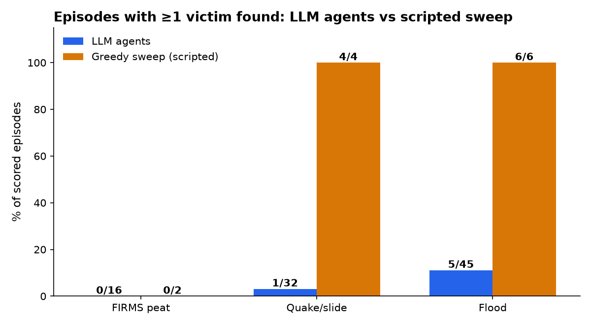
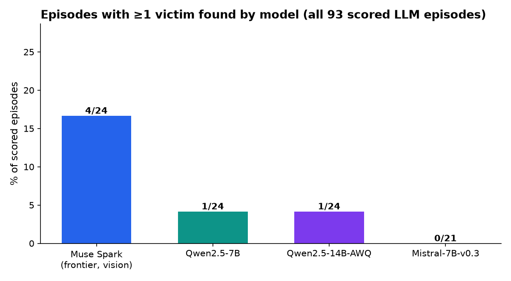
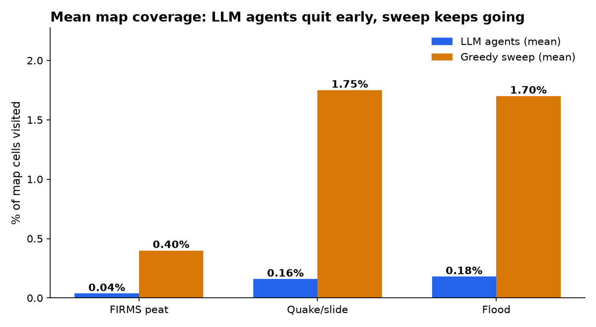

# Disaster Mitigation Bench

Benchmarking language models as **drone navigators** and
**reconnaissance advisors** in simulated 3D disaster environments.
Eval harness: [inspect-ai](https://inspect.aisi.org.uk/). Sim:
Gazebo-first (headless-capable, distributed). Inference: Baseten
frontier + Modal-hosted HuggingFace. All runs tracked.

- **Worlds**: hard disaster scenarios built from real internet
  assets (Fuel models, Polyhaven textures) and checked against
  real look references (NASA FIRMS fire data, Commons aerials),
  rendered and verified in Gazebo.
- **Agents**: ReAct drone missions (single + 2-drone fleets) over
  an ArduPilot-derived tool surface, with stub or SAM 3.1 edge
  perception (segmentation maps → routes + severity).
- **Scoring**: mission composite (rescue recall, containment,
  efficiency, safety) plus coverage, closest approach, and
  calibrated route metrics.

## Sim-to-real batches

| Batch | Worlds | Evals | Report |
|---|---|---|---|
| FIRMS peat (#79) | 120×120 Kalimantan/Sumatra peat tiles from MODIS hotspots | 16 LLM + 2 greedy | [harder-evals](docs/firms-sim2real/harder-evals.md) |
| Quake/slide (#80) | 60×60 quake town, 48×64 slide slope | 32 LLM + 4 greedy | [envs](docs/quake-slide-sim2real/envs.md) |
| Flood (#82) | 60×60 flood town, 48×64 flash valley, 60×60 tsunami coast | 48 LLM + 6 greedy | [envs](docs/flood-sim2real/envs.md) |

Footage (promo loops, run replays, final frames, segmentation
maps, survey frames) lives next to each report under
`docs/<batch>/renders/`.

## Results

Across **93 scored LLM episodes** (Baseten
`muse-spark-open-1026` with vision + Modal Qwen2.5-7B /
Mistral-7B-v0.3 / Qwen2.5-14B-AWQ, SAM vs stub, single vs
fleet) plus 12 scripted greedy baselines:



*LLM agents find a victim in 6/93 episodes; the scripted sweep
finds victims in every quake/slide and flood cell. FIRMS peat
(120×120) floors everyone.*

| Batch | LLM episodes w/ ≥1 find | Victims (LLM) | Greedy episodes w/ ≥1 find | Victims (greedy) |
|---|---|---|---|---|
| FIRMS peat | 0/16 | 0 | 0/2 | 0 |
| Quake/slide | 1/32 | 1 | 4/4 | 4 |
| Flood | 5/45 | 5 | 6/6 | 8 |



*The vision frontier accounts for 4 of the 6 LLM finds;
Mistral-7B never acts (0 actions in every completed cell,
100–200k tokens of fenced pseudo-calls, plus 3
context-overflow errors). Tsunami is a perfect 0/14.*



*Acting LLM agents cover ~0.1–0.5% of the map then submit;
coverage is unscored, so early-submit is score-rational.
Greedy covers ~2% and finds 1–2 victims per environment.*

Findings:

- **The evals are hard by design, and frontier performance
  sits near the floor.** 6 victims in 93 episodes; per batch
  FIRMS 0/16, quake/slide 1/32, flood 5/45.
- **Scripted coverage beats every LM.** The next scorer
  iteration needs coverage/closest-approach shaping before
  scale or finetuning can show signal.
- **SAM 3.1 perception works; routes add nothing yet.**
  Prompted segmentation goes 8/8 on firebeds, rubble, debris,
  and floodwater with calibrated severity, and SAM episodes
  request route maps. With ~0 located victims, routes cannot
  separate runs.
- **New worlds are cheap to add.** The builder +
  render-verify + survey-frame pipeline ships a hard
  environment with full evals in one batch (see
  [#81](https://github.com/sanggusti/automatic-octo-meme/issues/81)
  / [#82](https://github.com/sanggusti/automatic-octo-meme/pull/82)
  for the checklist).

Figures are generated from the batch tables by
[generate_results_graphs.py](docs/img/generate_results_graphs.py).
Open next steps: scorer shaping (#35), recon advisor + human
baselines (#5), release bar (#29).

## Repo map

- `dmb/`: package (scenarios, sim bridge, tools, solvers,
  scorers, perception incl. SAM, watcher)
- `evals/`: inspect-ai tasks (`flood.py`, `quake_slide.py`,
  `firms_peat.py`, packs, baselines)
- `scenarios/`: disaster definitions (+ `*_hard` variants)
- `assets/`: pinned Fuel/Polyhaven manifest, fetchers, Gazebo
  world builders (`assets/structures/build_*.py`)
- `infra/`: sim image + Modal vLLM serving definitions
- `docs/`: technical docs + per-batch reports and footage
- `runs/`, `logs/`: tracked trajectories and eval logs

## Quickstart

```bash
uv venv .venv
VIRTUAL_ENV=$PWD/.venv uv pip install -e ".[dev]"
cp .env.example .env   # then fill in provider keys
.venv/bin/python -m pytest -q
XDG_DATA_HOME=$PWD/.inspect-data INSPECT_LOG_DIR=./logs \
INSPECT_TRACE_FILE=./logs/trace.log \
  .venv/bin/inspect eval evals/forest_fire.py --model mockllm/model --limit 1
```

Harder evals (keys + serving required; see
[runbooks](docs/runbooks.md) and [inference](docs/inference.md)):

```bash
# one flood cell on the frontier (vision), SAM perception
DMB_RUN_ID=my-run DMB_EDGE_PERCEPTION=sam \
DMB_SAM_MAX_SCANS_PER_EPISODE=1 DMB_SAM_FUSE_STUB=1 \
  .venv/bin/inspect eval evals/flood.py@flood \
  --model openai-api/baseten/meta-models/muse-spark-open-1026
# replay it
.venv/bin/python -m dmb.watch.render runs/my-run/trajectories/*.jsonl --out /tmp/replay
```

## Docs

Start at [docs/](docs/README.md): architecture, compute split,
action surface, edge perception, SAM segmaps, scenarios,
metrics, inference, tracking, human evals, assets, runbooks,
roadmap, plus the per-batch sim-to-real reports with
performance tables and footage.

## Contributing

Issues first, then PR, then merge, then close. No direct pushes
to `main`. See [runbooks](docs/runbooks.md#publishing-flow-required).
