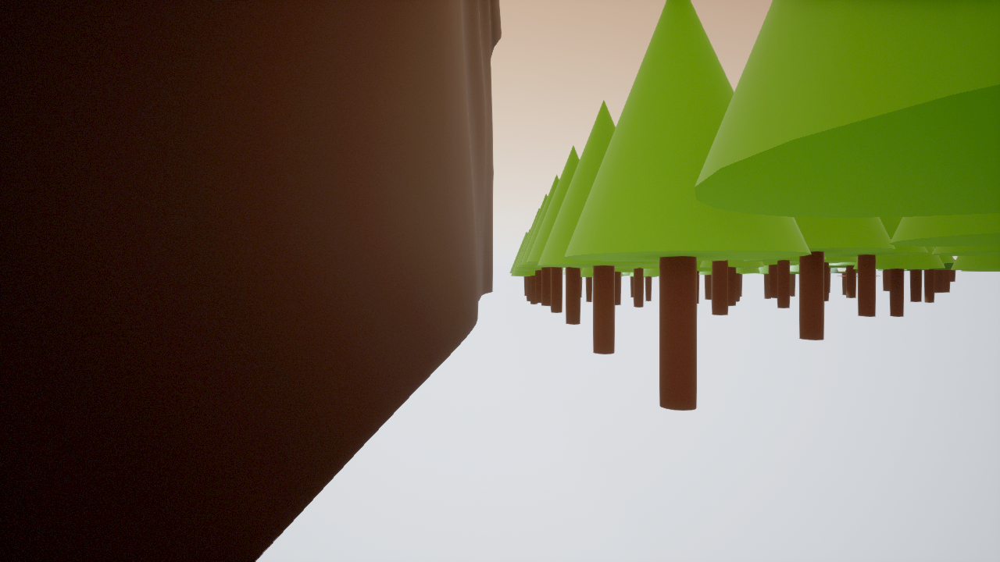
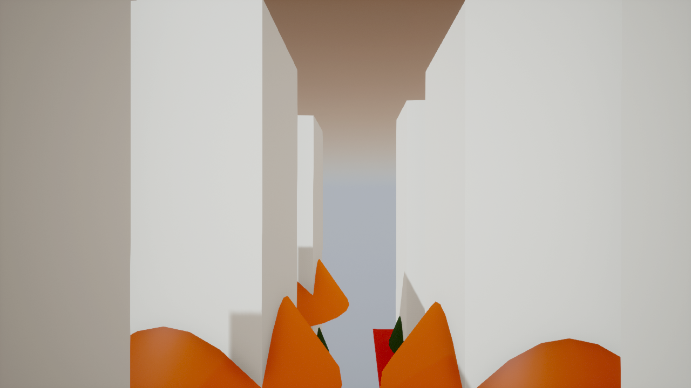

# Custom Colosseum env guide (DMB workstation)

How to build a new drone env (a second disaster, a new map) on the GPU
workstation without re-learning every gotcha. Distilled from the
ForestFire env ([whiteout record](forest-fire-whiteout.md)); the
[runbook](track2-runbook.md) covers daily start/stop/fly, the
`unreal-colosseum` skill is the condensed checklist.

## 0. Map of the docs

- This guide: build a NEW env end to end.
- `forest-fire-whiteout.md`: the two big bisects (sun whiteout, BGR
  swatches) with evidence tables.
- `track2-runbook.md` §6–§7: start/stop, hello flight, verdict rollout.
- `unreal/forest_fire/tools/`: the reference generator scripts.

## 1. Toolchain checklist (do once per machine)

- **UE 5.6** (Colosseum main is 5.6-only). UE 5.8 on the same PC
  **cannot** build flight — never upgrade the env to it.
- VS2022 + NativeDesktop + Win10 SDK + cmake (AirLib takes the newest
  SDK; no pin).
- Checkouts: `D:\programming\Colosseum` (main source),
  `D:\programming\Colosseum-beta` (beta client for the old binary),
  envs under `D:\programming\Colosseum-env\`.
- `settings.json` with a Multirotor entry at
  `%USERPROFILE%\Documents\AirSim\settings.json`, else the RPC server
  never starts.
- `LauncherInstalled.dat` may not list the engines, so never rely on
  UnrealVersionSelector — call UBT/RunUAT/Editor by absolute path, and
  prefer `Start-Process` over `&` (the call operator flakes in
  sandboxed shells). Never pipe UBT through `Select-Object -First N`.

## 2. Project setup (Colosseum `unreal_custenv` + fixes)

1. C++ project, game module depending on `AirSim`; copy the built
   `Unreal/Plugins` tree into it. Our checkout names the plugin
   **AirSim**, not Colosseum.
2. `.uproject`: enable `AirSim` + `PythonScriptPlugin` (Editor-only),
   `EngineAssociation` = an installed 5.6.
3. `Config/DefaultGame.ini` must cook the maps plus
   `/AirSim/AirSimAssets` and `/AirSim/HUDAssets`.
4. Generate project files with UBT directly; build the Editor target.
5. **Every map** needs a PlayerStart on clear ground and a
   WorldSettings GameMode override =
   `/Script/AirSim.AirSimGameMode` — without it there is no RPC
   server and the game idles on GameModeBase.

## 3. Map generation gotchas

One map per `-cmd` editor session (`DMB_MAPS=before|burning` pattern):
building two maps with `new_level` in one session can silently save
the first empty. `new_level` refuses existing paths, so delete-first,
save through the asset library, and prove the `.umap` on disk. Then
**reload every map from disk** and assert actor counts + GameMode
before packaging.

- **Materials**: on constants only `""` and `"R"` pins exist;
  feed colors via PNG swatches + TextureSample `"RGB"` into color
  inputs only. Never wire `"RGB"` into scalar inputs
  (roughness/specular) — it whites frames. Delete-recreate on
  rebuild, `save_asset` after edits, assert every connect.
- **Textures**: delete-recreate on reimport too
  (`replace_existing` leaves stale bulk data). The stdlib PNG
  writer's bytes render R/B-swapped in-engine (blue flames!), so it
  pre-swaps to BGR — pinned by test, see below.
- **Lights**: movable sun + movable skylight, no lightmap bake.
  Sun intensity **10, never physical 75k** (whites all Scene
  captures). Set `atmosphere_sun_light` (black sky otherwise) and
  skylight `real_time_capture`. Fog tint is
  `fog_inscattering_luminance` in 5.6 (old name missing from Python).
- **Collision**: terrain complex-as-simple, trees collide, all
  markers/decor `NO_COLLISION` or the drone wedges on them.
- **No `line_trace_single` under `-cmd`** (no physics scene):
  bake analytic heights into a sidecar and sample it.
- Grid (x=east, y=north) → UE cm; PlayerStart at the grid corner,
  trees at cell centers. Heads-up: spawn-adjacent trees crowd the
  default camera — the brown mass at frame left here is the nearest
  trunk 3.5 m away, not a bug:



What good looks like from altitude (sepia haze, fog-driven):


## 4. Packaging

```powershell
RunUAT.bat BuildCookRun -project='<X>.uproject' -platform=Win64
  -clientconfig=Development -cook -build -stage -pak -archive
  -archivedirectory='<out>' -unattended -utf8output
```

- Incremental cook ≈ 20 s; clean recook (delete `Saved/Cooked` +
  `Saved/StagedBuilds`) ≈ 1 min; first full shader compile ≈ 20 min.
- The cook is the only place material shaders compile: always verify
  on packaged builds, never `-game`. Stop the running game before
  re-archiving over its directory.
- Boot per map: `<Pkg>.exe <MapName> -RenderOffScreen -ResX=1280
  -ResY=720`, then wait for port 41451.

## 5. Flight + capture rules

- **Client**: custom main-branch builds need the MAIN PythonClient
  (`D:\programming\Colosseum\PythonClient`); the beta client
  connects but cannot parse their poses. The old Blocks binary
  needs the beta client. One vehicle per episode.
- **Never `.join()` a `moveToPositionAsync`**: moves can be
  silently ignored and the join hangs forever even at clear
  altitude. Fire-and-poll the pose with a timeout, then
  `hoverAsync().join()` to cancel before the next leg. Climb
  first, prefer altitudes above clutter, assert poses per leg.
  Rotate/takeoff/land joins are safe.
- **Never `simSetCameraPose`** during verification: poses persist
  across `reset()` and poison later captures. Fly the drone for
  angles; capture the default camera (`simGetImages` Scene +
  Segmentation). If poses were touched, restart the game.
- Kill orphaned `python.exe` after any timeout kill (watchdog
  kills the wrapper, the RPC client survives).

## 6. Troubleshooting matrix

| Symptom | Cause | Fix |
|---|---|---|
| Scene pure white, seg/normals fine | sun too bright for capture exposure | sun intensity 10 (see whiteout record) |
| Flames blue, trunks navy, sky sepia correct | swatch R/B swap in textured materials | BGR pre-swap writer (pinned by test) |
| Black scene / "lighting needs rebuild" | static lights, no bake | movable sun + skylight |
| `.join()` hangs, pose frozen | move ignored (not just wedging) | poll + hover-cancel pattern |
| Identical-byte frames across poses | camera pose touched earlier | restart game, fly don't teleport camera |
| Float Scene capture all zeros | unsupported path, not black HDR | ignore; use LDR + seg |
| "Manual exposure" changes nothing | **no exposure API exists** in either client | don't test it; fix lights instead |
| Both maps broken identically | shared rig (sun/sky/base materials) | Before-vs-Burning narrows it |
| White only on one map | that map's markers/fog | compare densities + marker sets |

The whiteout vs the fix (same pipeline, sun 75k → 10):




## 7. Recording + tests

- Post versions, commands, and evidence tables (means + white_frac
  per capture) to the tracking issue per step; the user compiles
  reports from them.
- Promote key frames to `docs/img/` + a short evidence doc per
  env — `runs/` is git-ignored working output, curate deliberately.
- Pin generators with tests: `tests/test_terrain_gen.py`
  (determinism + BGR order) is the pattern. Full suite must stay
  green; SITL-integration needs Docker and stays out of the
  default local run.
