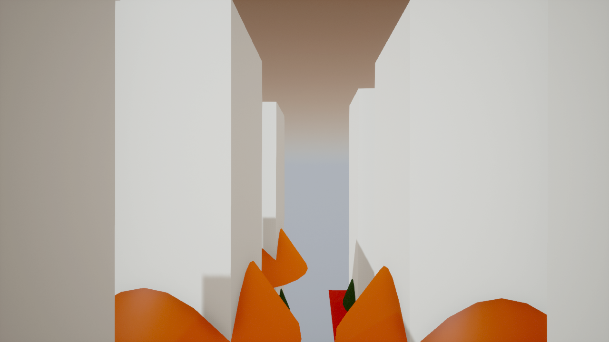
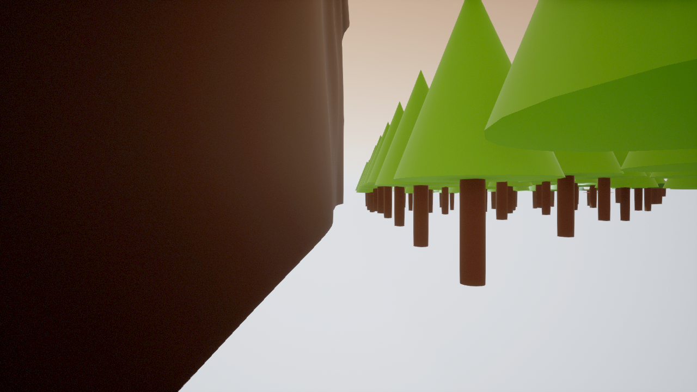
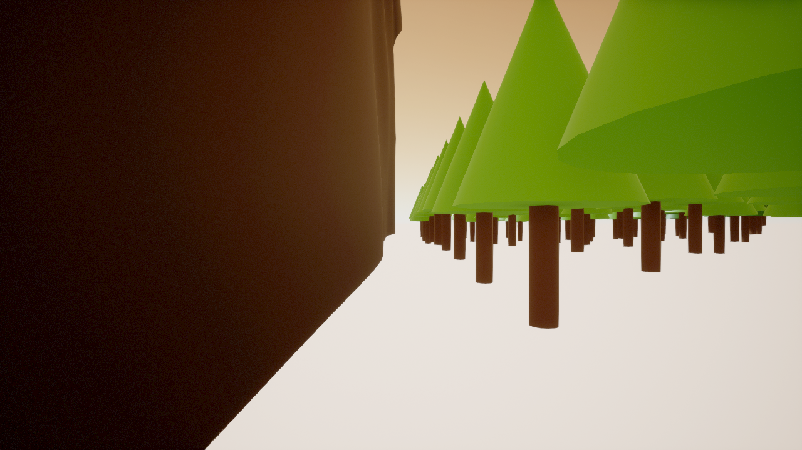

# Forest-fire env: whiteout root cause + live verification (#50)

Packaged `ForestFire` env (UE 5.6 + Colosseum main) rendered every Scene
capture pure white from package 9 on. Two content bugs found by bisect;
both fixed in `unreal/forest_fire/tools/` and verified on packaged builds.

## 1. Whiteout: sun 75k lux blows out the capture pipeline

Bisect (Burning map, default camera, `simGetImages` Scene 1280x720):

| Step | Change | Scene result |
|---|---|---|
| pkg8 baseline | last-known-good package | renders (forest + sky) |
| pkg9–12 | generator edits (materials/lit) | pure-255 white, both maps |
| DXCache purge + re-fly pkg12 | 176/197 NVIDIA entries cleared | still white 7/7 |
| Full clean recook + repackage | `Saved/Cooked` + `StagedBuilds` deleted | still white 8/8 |
| **B1: sun 75000 → 10** | editor edit, no rebuild | **renders, white=0.0000** |
| B2: sun 75k + skylight `real_time_capture=False` | editor edit | still white 8/8 |
| Final: sun=10 in `ue_build_maps.py`, maps rebuilt | repo script | renders 13/13, deterministic |

Throughout: segmentation + surface normals rendered correct geometry
from the same poses, cook logs clean for map content, driver
(32.0.16.1088, July 2026) and plugin binaries constant. The blowout is
the sun level vs the capture pipeline's exposure range; scene brightness
is emissive/fog-driven anyway. Skylight real-time capture is innocent.
True physical daylight needs a PostProcessVolume + exposure tuning
(open follow-up, not needed for placeholder art).

Fix: `ue_build_maps.py` sets DirectionalLight intensity `10.0`.

## 2. Blue flames: swatch PNGs render R/B-swapped

With the whiteout fixed, flames rendered vivid blue instead of orange
(`(255,122,26)`), trunks navy instead of brown — while procedural
fog/sky kept correct sepia, proving the capture decode is fine and the
swap is in textured materials. Delete-first texture reimport did not
help (stale-bulk theory dead). Fix: `terrain_gen.py` writes swatch
bytes B,G,R; pinned by `tests/test_terrain_gen.py` (do not "fix" the
order without a packaged capture proving orange flames).

After the fix: blue pixels 0 in all frames, thousands of orange pixels
wherever fire is in view; trunks brown, canopy green.

## 3. Live verification (final package, 2026-11-03)

- Maps rebuilt from repo script, verified by reload:
  Before 100 trees / Burning 100 trees + 27 flames + 50 smoke.
- Burning renders 13/13 Scene captures, white=0.0000; Before renders
  2/2 (ground + climb).
- Hello flight green on Burning: arm → takeoff 10.2 m →
  arrived (2, 2) → landed, 678 KB native frame.
- Verdict rollout mock-vs-Colosseum on `forest_fire_peat` seeds 1–3:
  **3/3 match, zero diffs, non-vacuous**
  (recall 0.5/0.5/0.6, safety 1.0, found_any 1.0).

## 4. Flight notes (folded into the Unreal skill)

- Never `.join()` a `moveToPositionAsync`: moves can be silently
  ignored and the join hangs forever even at clear altitude. Fire-and-
  poll the pose with a timeout, then `hoverAsync().join()` to cancel
  before the next leg. Rotate/takeoff/land joins are safe.
- Custom main-branch builds need the main PythonClient
  (`D:\programming\Colosseum\PythonClient`); the beta client connects
  but cannot parse their poses.
