# Peatforest env report: `PeatBefore` + `PeatBurning` (#64/#65/#66)

Real-data Indonesian peatland maps for UE5.6 + Colosseum: DEM terrain,
Sentinel-2 albedo, WorldCover-driven forest, FIRMS fire fronts. Both
variants fly; all acceptance items green (2026-11-03).

## Tile + reasoning

- **Bbox (tile C):** `[114.318, -2.86, 114.336, -2.842]` (~2x2 km,
  ex-Mega-Rice-Project peatland, Central Kalimantan).
- **Why this tile:** densest 2 km FIRMS cell in the Sept 2019 window
  (10 MODIS hotspots 2019-09-07..21); DEM flat peat relief 1.26-14.22 m
  (no voids); WorldCover mosaic 42% tree / 36% grass / 19% shrub (real
  stand/clearing structure, not uniform forest); clean peak-haze
  Sentinel-2 scene 2019-10-23 T50MKB (local cloud 0.0016).
- **Why 2019, not 2026:** 2026 has no in-box cluster and MCD64 is
  unreleased; 2019 gives a real cluster + scars + clean S2 (operator
  picked the Recommended option; re-tiling 2026 later is a follow-up).

## Data pins (all in `assets/manifest.yaml`, `gis:` section)

| pin | version | sha256 (prefix) |
|---|---|---|
| Copernicus DEM GLO-30 S03E114 | `Copernicus_DSM_COG_10_S03_00_E114_00_DEM` | `99d1be80…` |
| ESA WorldCover 2021 S03E114 | `…_v200_S03E114` (asset map) | `85c05050…` |
| Sentinel-2 L2A visual | `S2A_MSIL2A_20191023T022741…T50MKB…` (asset visual) | `9e6f2492…` |
| Sentinel-2 L2A SCL | same item (asset SCL) | `bd2b9f45…` |
| FIRMS MODIS C6.1 archive | `DL_FIRE_M-C61_836813.zip`, ID 2019-09-01..10-31, 81119 rows | `ca7113a1…` |

Bulk GeoTIFFs live in untracked `data/peatforest/`; map datasets go to
HuggingFace (tag `3D maps`), never GitHub/LFS — this repo keeps
metadata + entrypoints only.

## Reproducibility

- **Seed 7** everywhere (`gen_terrain.py`, `gen_groves.py`, placements).
- Pipeline: `prep_tile.py` (tile stats + fronts) → `gen_terrain.py`
  (terrain/collision/albedo/placements/canals/ops) → `gen_groves.py`
  (merged grove OBJs) → `ue_build_peat.py` (`DMB_MAPS=before|burning`)
  → RunUAT `BuildCookRun` → packaged `.exe <Map>`.
- XY scale: 1 unit = 1 cm, tile 200000x200000 (2 km), 4 m terrain grid
  (500x500), Z = DEM metres x100. Albedo 2048 px S2 window.
- Ops area: flattest 20x20 m near SW corner (`ops.json`).

## Verification (packaged build, Colosseum API)

- **Build asserts:** flatness (`ext.z < ext.x/10`), >=6 mesh actors,
  1 PlayerStart, `AirSimGameMode`, fire markers on burning, spawn_z
  inside DEM cm range, collision readbacks. Verdicts:
  `{"before": {"meshes": 7, ...}}`,
  `{"burning": {"meshes": 8, "flames": 10, "smoke": 10}}`.
- **Surveys (both maps):** takeoff + 23.7 m flown legs, ground +
  100 m yaw sweeps + fire approaches, Scene/Seg/DepthVis. White 0.0
  everywhere; depth varied (no walls).
- **Hello (green):** arm → takeoff `(0,0,-1.7)` → goto `(27.5,0,-7.5)` →
  1280x720 native frame → touchdown `(31.2,0,+0.4)`, `collided=true`
  (shell stops descent; `landAsync` itself has an upstream spool race,
  so touchdown uses open-loop velocity-descend — see gotchas).
- **Mock eval end-to-end on PeatBurning:** `forest_fire_peat` rollout
  (arm/takeoff/goto 2 victims/land), mock-vs-bridge seeds 1+2:
  **match, recall 0.5, safety 1.0, found_any 1.0** (non-vacuous).
  Mock-only seeds 1-3: recall 0.5-0.6.
- **Spawn/bounds:** spawn = tile SW corner, local NED origin
  (`PlayerStart` at UE `(0,0,708cm)`); usable bounds x,y in
  `[0,2000]` m, tested 0-100 m altitude; grid contract 5 m/cell
  around spawn (`dmb/sim/colosseum_bridge.py`).

## Counts + performance

- 4000 trees (3314 healthy + 686 charred within 250 m of hotspots),
  10 flame + 10 smoke + 10 glow markers, 3 canal strips.
- Triangles: terrain 498k, hidden shell 20k, trunks 53k, canopy
  26.5k, charred 11k (~609k burning total, 8 draw actors).
- Capture round-trip at h100 (1280x720 Scene, 30 rounds): **median
  39 ms (25.7 fps), p95 52 ms** on RTX 5060 Ti. This includes render
  + readback + msgpack transfer, so in-engine fps is higher; same
  method as the ForestFire 29 fps baseline.

## Keyframes

Before (lush) and burning (charred + fire + haze) states of the same tile:

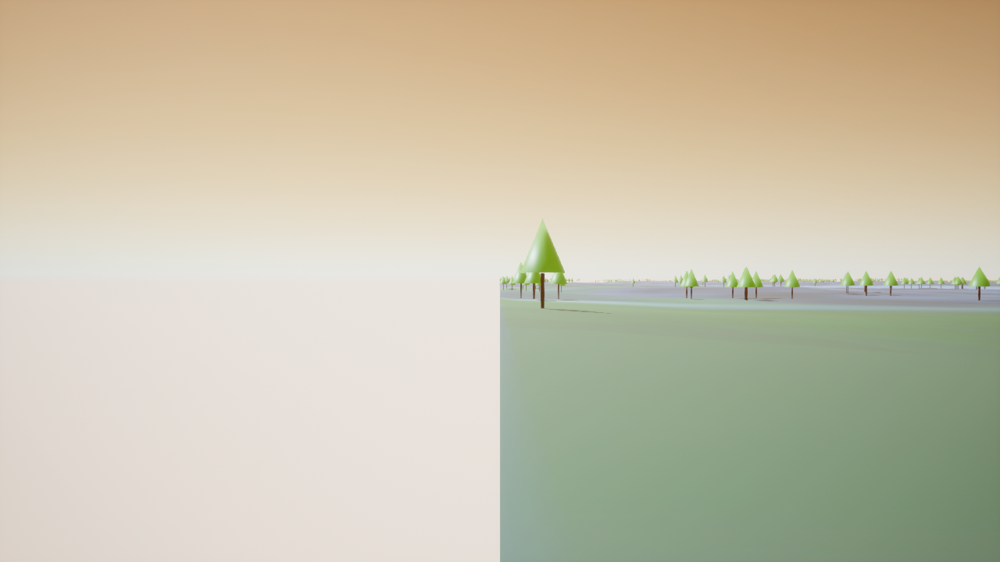
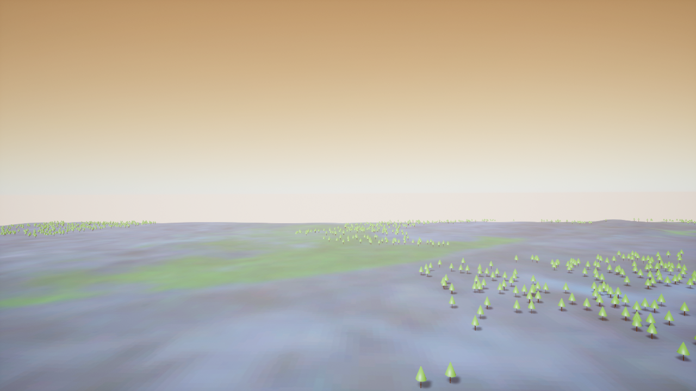
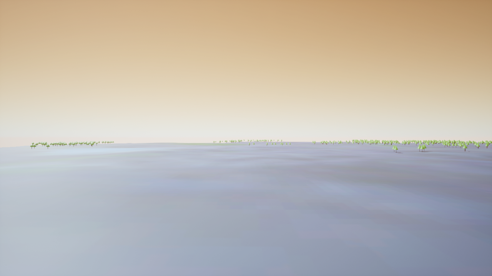
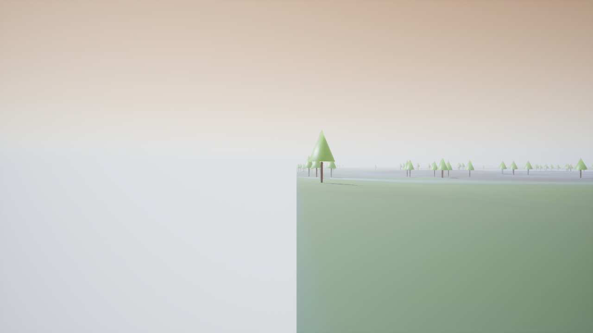
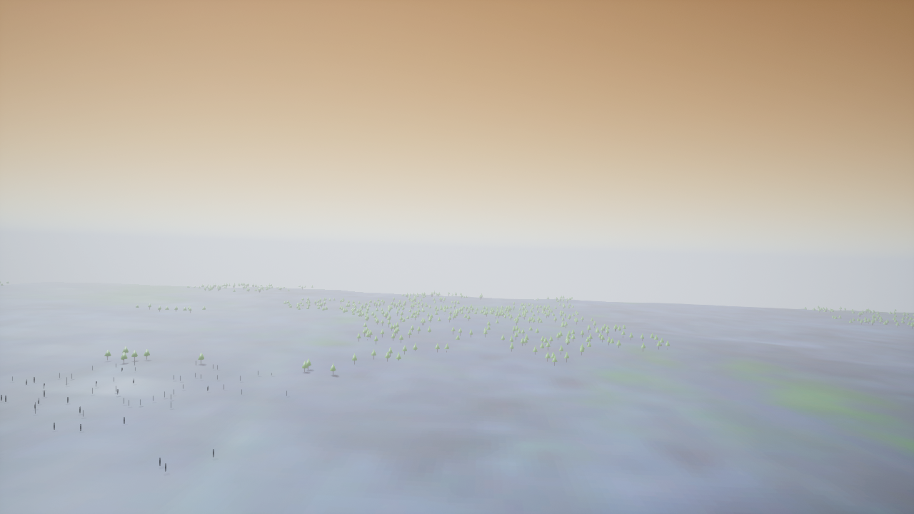
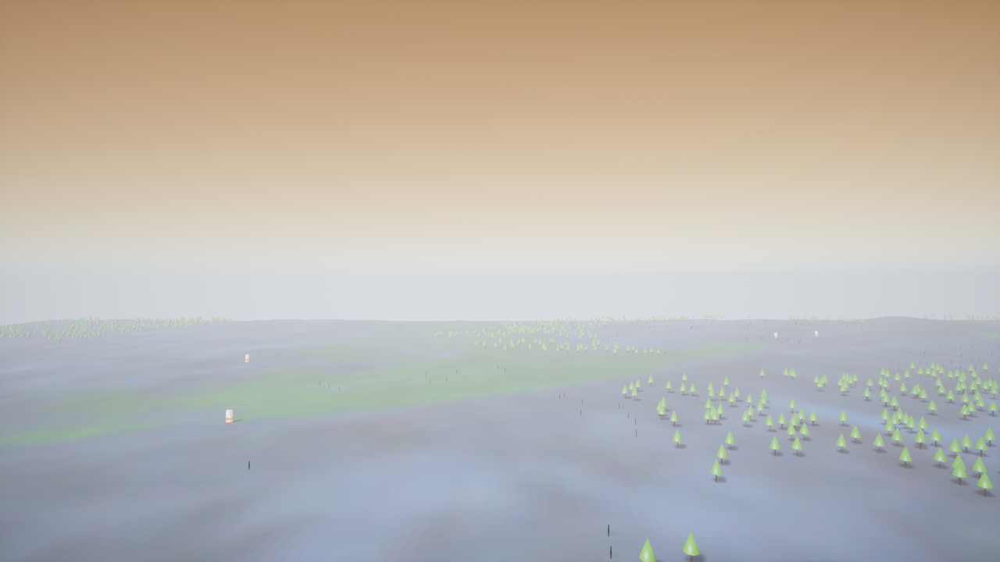
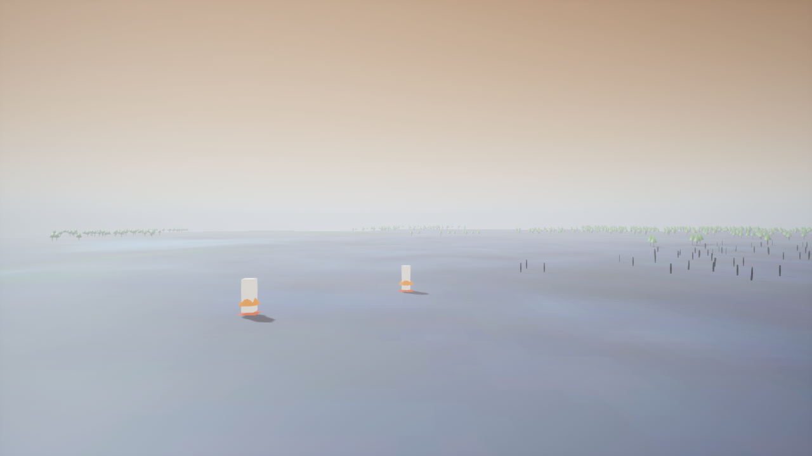
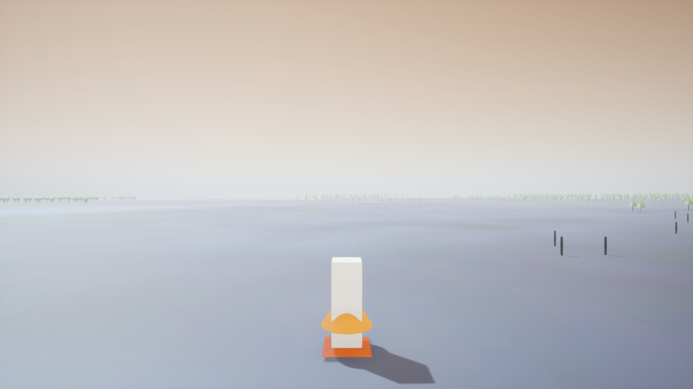
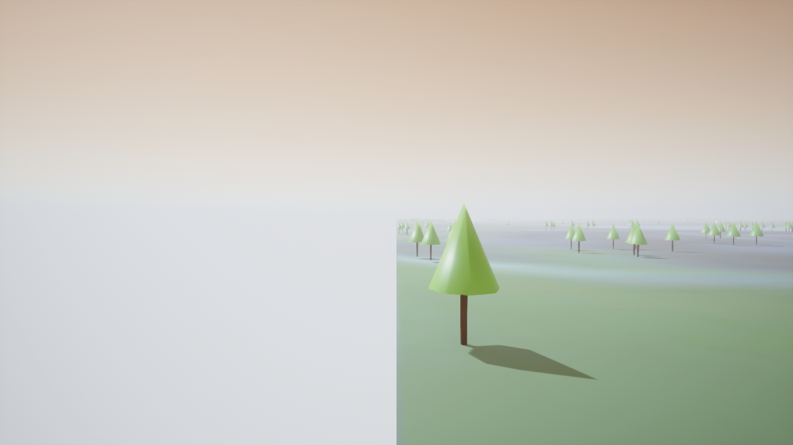

## Bugs found + fixed (all verified live, all pinned by tests)

1. **Y-up wall:** UE imports OBJ Z verbatim; Y-up writers rendered as
   a vertical wall 100 m tall. Fix: Z-up writers + flatness assert.
2. **Y-mirror:** UE5.6 Interchange maps OBJ `(x,y,z)->(X,-Y,Z)`.
   `+y` OBJ content landed at NED `-y` while builder-placed markers at
   `+Y` landed `+y` — terrain/fires split across the tile edge:

   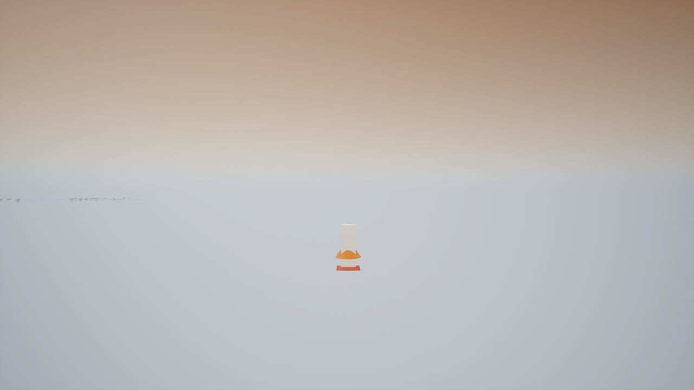
   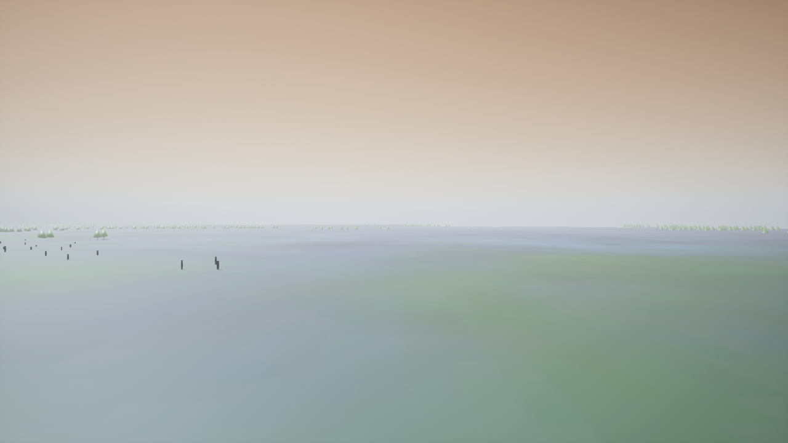

   Fix: writers emit `y=-east_cm` (+Z winding kept); sign pinned in
   `tests/test_obj_winding.py`. ForestFire maps carry the same latent
   mirror (follow-up: rebuild them from the fixed writers).
3. **Heights unit slip:** `heights.json` stored DEM metres under a
   `heights_cm` key: every tree buried (coplanar bases), canals
   buried, drone spawned 6.8 m underground. Invisible at first because
   the single-sided terrain is see-through from below (the white
   "ground" was void). Fix: x100 at the source + repo test + build
   assert (spawn inside DEM cm range).
4. **Collision that isn't:** `set_collision_enabled(NO_COLLISION)`
   reverts to BLOCK on save+reload (probed A/B/C). Auto-decomposed
   hulls on km-scale merged meshes are solid rock: drones spawned
   inside, all low moves died (works above ~15 m only). Fix: the
   `"NoCollision"` profile (persists; probed) + build-time readback
   assert. Only the hidden 101x101 shell collides (complex-as-simple);
   groves are no-collision until the foliage/Quixel pass. ForestFire
   builders share the setter bug (fixed in-repo; map rebuild
   follow-up).
5. **Shell unit slip:** collision shell XY written in metres (20 m
   patch). Fix + extent-match test.
6. **`landAsync` spool race (upstream):** land completes when z-vel
   reads ~0 ten times; from hover the checks can all land before the
   motors spool, so land no-ops mid-air. Workaround: open-loop
   velocity-descend to touchdown (used by hello/touch tests).
7. **Teleport imprecision:** long `simSetVehiclePose` jumps land
   ~+/-25 m off and can leave the drone swinging (rolled frames).
   Fix: teleport-coarse, then `fly_to` exact + orientation-gated
   settle (`settle_level`: pitch/roll < 3°) before every capture.
8. **Sandbox vs UE:** the shell sandbox blocks the editor's
   DerivedDataCache + all project-dir writes; UE builds/packages/game
   runs need one-shot escalation (`require_escalated`).

## Deviations from the brief

- Stand-in cone/cylinder groves (seeded, WorldCover-placed) instead
  of Quixel tropical broadleaf: no Bridge/Fab cache or Epic-signed
  pull on this box; swap path open (mesh assignment is builder-side).
- Groves + markers + canals are no-collision (merged-mesh auto-hulls
  unusable); only terrain collides. Tree collision returns with
  foliage/Quixel instancing.
- 2019 fire season, not 2026 (data-driven, operator-approved).
- Fire markers 4.4 m: read well at <=120 m and as dots at 1 km; no
  particle systems yet (cones/cubes/planes, emissive).
- No streaming assets / no runtime tokens (deterministic; same seed +
  pins = same map). `stat fps` unavailable headless, hence the
  capture-cadence perf method.

## Hi-fi pass v1 (concluded, fidelity open)

Goal was UE5-grade lush forest + real fire. Landed the structure;
fidelity reaches ~30% of the reference look and is NOT eval-ready.
Follow-up issues carry the remaining work; this section pins what
v1 proved.

Refs (targets): 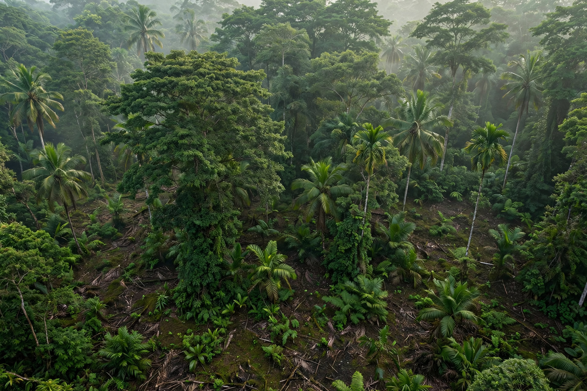
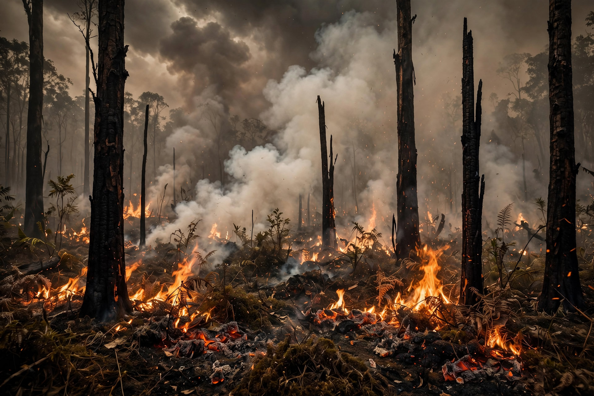
(PRD: `docs/peatforest-fidelity.md`.)

What v1 built (all seeded, seed 7):

- PBR pins (`assets/manifest.yaml`, `pbr:`): bark, peat-mud
  (diffuse+normal), burned ground (CC0, PolyHaven, hash-verified).
- `gen_textures.py`: leaf_card, frond, flame (hottest at base),
  smoke, glow, burn_patch alpha textures.
- `gen_groves.py` v2: 4 variants (emergent/palm/round/bush) +
  charred snags/logs, UVs, per-tree tints; 118 MB merged OBJs.
- `ue_build_peat.py` v2: Nanite meshes, PBR bark/ground-detail/
  burn materials, masked canopy/frond/flame, scrolling flame +
  smoke, 10 orange point lights (no shadows), 8000 K sun,
  `used_with_nanite` on all materials.

Verification (packaged `ForestFire-Pkg`, Colosseum API, unsandboxed):

- `{"before": {"meshes": 8}}`,
  `{"burning": {"meshes": 9, "flames": 10, "smoke": 10,
  "lights": 10}}`; reload-verify + flatness + spawn asserts pass.
- RunUAT: BUILD SUCCESSFUL. Surveys green both maps (23.7 m
  flown legs, white 0.0, depth varied). 134 pytest pass.

Keyframes (v1):

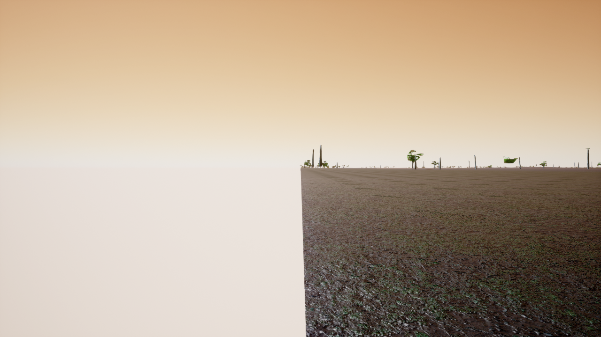
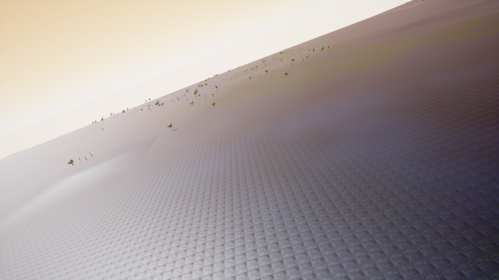
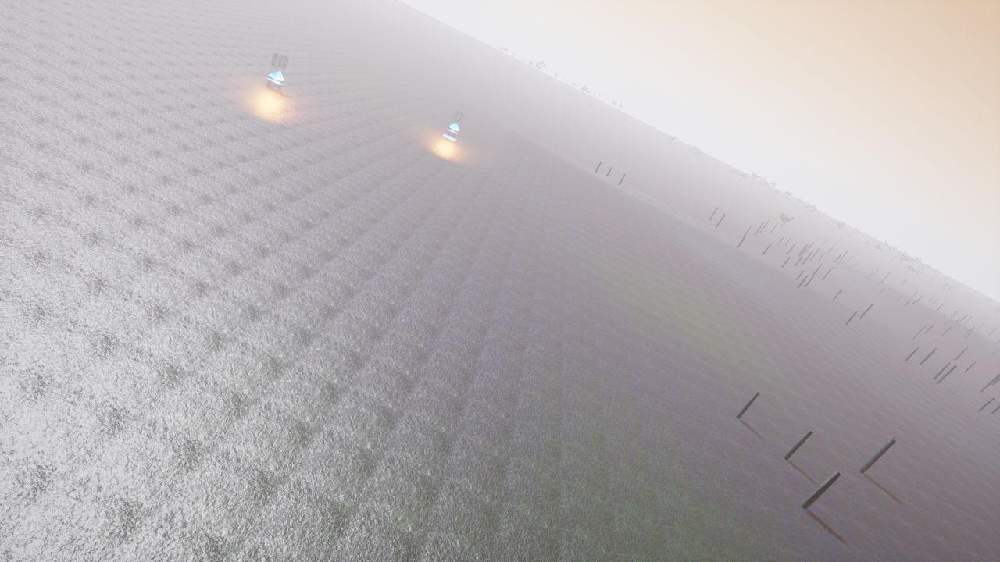
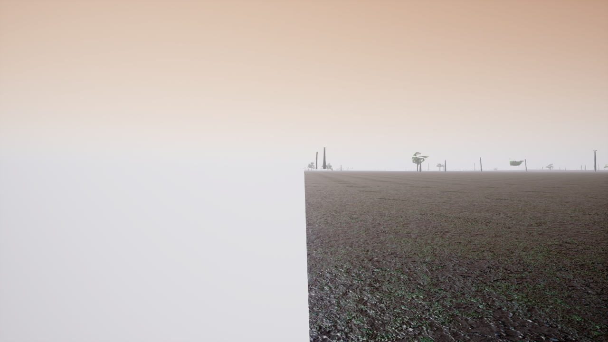

Gaps (all visible above; each has a follow-up issue):

1. Half the ground renders flat white (spawn views) — sharp
   vertical split, ground only, undiagnosed.
2. Trees read as sticks: trunks render, canopy blobs nearly
   invisible (leaf-mask eating blobs? blob UVs?).
3. Ground gray-lavender, not peat green: S2 albedo looks
   unapplied (UV range suspect).
4. Flames blue-white, not orange (R/B order or mask-out).
5. Survey frames roll (no level-settle); touch-check drifts.

Bugs found + fixed in v1:

- Materials on Nanite meshes render DEFAULT GRAY without the
  `used_with_nanite` usage flag (no `b_` prefix; probed).
- `MaterialExpressionVertexColor` connect crashes the editor
  (3x, access violation); tints stay baked/constant for now.
- **Sandbox blocks loopback TCP** (WinError 10013): in-sandbox
  RPC clients fail with "port never opened" while the game
  LISTENs fine. All surveys/RPC/game runs need `require_escalated`.
- Kill games by NAME (bootstrap + inner exe): a stale inner
  holds 41451 and the next boot bind-fails into an invisible
  headless modal (`FMessageDialog::Open` blocks the game thread).
- AirSim `LogMessage` is screen-only (all `UE_LOG` commented
  out): RPC startup failures never reach the packaged log.
