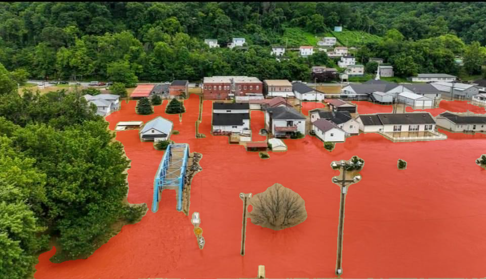
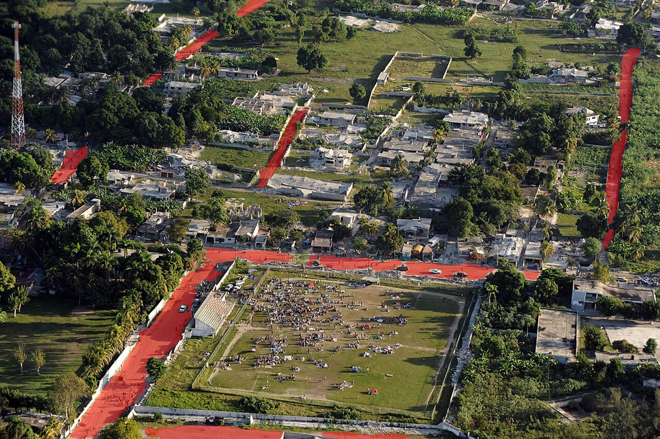
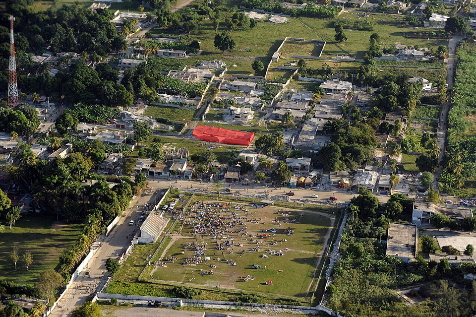
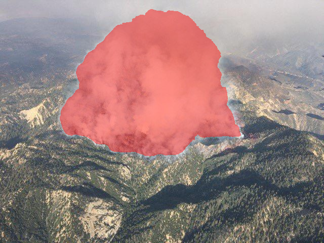
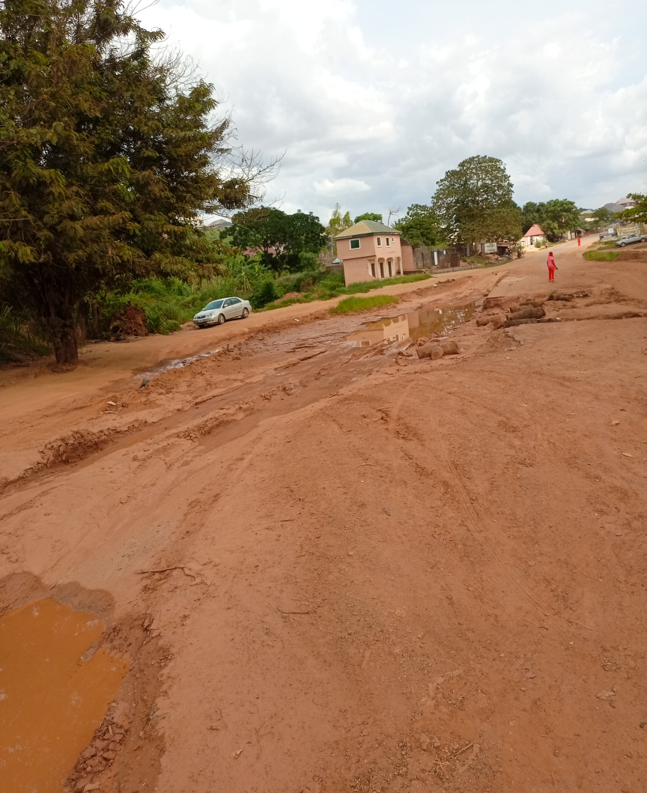

# Progress report: SAM 3.1 route mapping (2026-11-02)

Drone footage → SAM 3.1 segmentation maps → grounded grid costs → A*
rescuer routes, inside the existing edge-first architecture. Design doc:
[sam-segmap](sam-segmap.md). Registry records: `runs/sam-routes-v1/`
(capability + evidence) and `runs/sam-routes-regress-01/` (regression
eval).

## What shipped

- `dmb/perception/sam.py` — SAM client, grammar parser (image + video),
  scenario concept table, overlap rules, severity, `SAMEdgePerception`.
- `dmb/perception/grounding.py` — pinhole pixel→grid math (assumed
  nadir survey stance until calibration lands).
- `dmb/perception/segmap.py` — cost grid, A* planner, rescuer text.
- `request_route_map` tool (SAM-only, one snapshot) + solver
  `DMB_EDGE_PERCEPTION=stub|sam` switch (default stub: no behavior
  change).
- 31 new tests (real-API fixtures); suite 120 passed, 4 skipped
  (pre-existing SITL/docker skips).

## Live baseline (35 image + 90 video frames, $0.105)

Plain nouns hit; state phrases and damage nouns miss and must be
derived in app code (road ∩ water = flooded road):

| Image | Hits (matches, mean conf) | Zero |
|---|---|---|
| Flood town aerial | flooded road 1/0.91, house 41/0.77, water 1/0.81 | road (submerged) |
| Flood urban aerial | building 50/0.68, vehicle 9, road 1, water 1, car 2 | flooded street |
| Quake aerial | building 44, house 45, road 6, car 12 | rubble, debris, pile, collapsed/destroyed building, concrete |
| Wildfire aerial | smoke 1/0.69 (frame 0.23) | fire, forest, road |
| Road damage (ground) | person 2, road 1/0.55 (frame 0.55), car 2/0.89, water 2 | damaged road |
| Sim top-down map | — | victim (renders unsegmentable) |

Video: 90/90 frames, 16/16 houses tracked with stable IDs in 7.4 s.
Rubble fallback: point prompt + negative road point → rubble mask at
0.906 (box prompt: 0.555).











## Route demo (deterministic, stub segmenter)

```
episode: flood seed=2 drone=(5, 5) alt=25m grid=14x10
grounded road cells: [(2, 4), (2, 5), (7, 4), (7, 5)]
grounded water cells: [(6, 4), (6, 5), (7, 4), (7, 5)]
blocked cells: [(7, 4), (7, 5)]
Route map from (5, 5) (assumed survey geometry): severity=minor(0.00) blockages=[flooded_road:0.50].
Victim (11,2): 9 steps, 45.0 m, path: (5,5) -> (5,4) -> (5,3) -> (5,2) -> (6,2) -> (7,2) -> (8,2) -> (9,2) -> (10,2) -> (11,2).
```

The route avoids all water and blocked cells. Full output:
`runs/sam-routes-v1/demo.txt`.

## Limits and next steps

1. Native photorealistic frames only; route-map evals need
   gazebo-sitl/colosseum.
2. Camera calibration (gimbal survey command + FOV/pose logging).
3. Scan budget before provider-backed SAM evals (~$0.013/scan,
   per-step scanning is a cost hazard).
4. Rubble fallback wiring: road-gap points → point prompts.
